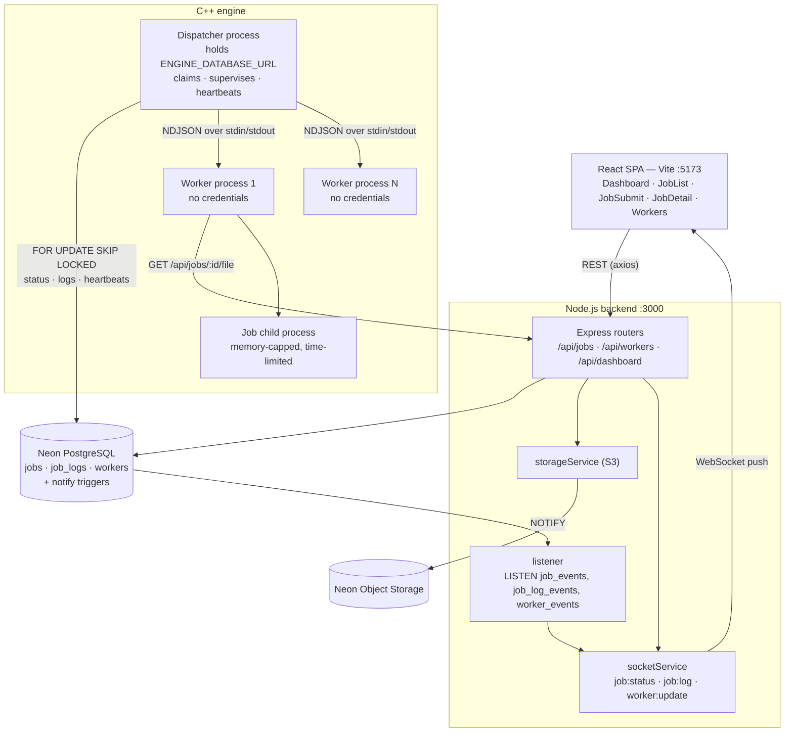
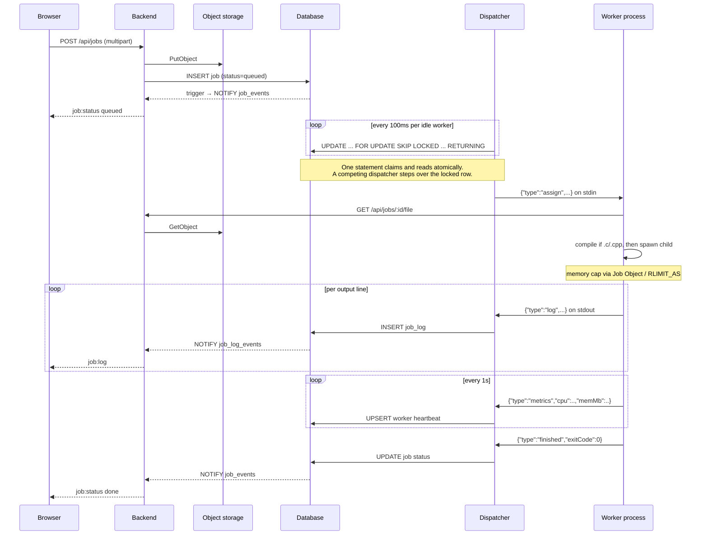
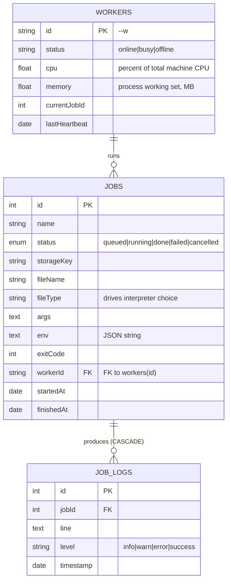

# Architecture — Database-backed Process Execution System

Four process layers across three codebases, coordinating through one PostgreSQL
database and one S3-compatible object store.

| Component | Stack | Port | Responsibility |
|---|---|---|---|
| `frontend/` | React 19 + Vite, axios, socket.io-client | 5173 (dev) | Submit jobs, watch status and logs live |
| `backend/` | Node.js, Express, Sequelize, Socket.io, AWS SDK v3 | 3000 | REST API, file storage, event fan-out |
| `engine/` dispatcher | C++17, libpq, httplib, nlohmann/json | — | Claim jobs from PostgreSQL, supervise workers |
| `engine/` worker | same binary, `--role worker` | — | Run one job at a time as a child process |

External services: **Neon PostgreSQL** and **Neon Object Storage** (S3-compatible).

---

## 1. Component view



**The credential boundary is the organising principle.** Only the dispatcher
holds `ENGINE_DATABASE_URL`. Workers are spawned with an explicitly constructed
environment from which `DATABASE_URL`, `AWS_*`, `NEON_*` and `PG*` are stripped,
so uploaded code — which runs as a grandchild of the dispatcher — cannot read a
credential out of its own environment. This is verified by test, not assumed.

| Component | PostgreSQL | Backend REST | Credentials in environment |
|---|---|---|---|
| Dispatcher | yes (`engine_role`) | health check only | yes |
| Worker | no | `GET /api/jobs/:id/file` | **no** |
| Job child | no | no | **no** |

## 2. Job lifecycle



## 3. Data model



`jobs."workerId"` is a foreign key to `workers(id)`, so **a worker row must exist
before its first claim** — the dispatcher upserts it on the `ready` handshake.

## 4. Key mechanisms

**Atomic claim.** One statement, so one implicit transaction:

```sql
UPDATE jobs SET status='running', "workerId"=$1, "startedAt"=NOW(), "updatedAt"=NOW()
WHERE id = (SELECT id FROM jobs WHERE status='queued'
            ORDER BY "createdAt" FOR UPDATE SKIP LOCKED LIMIT 1)
RETURNING id, name, "fileName", "fileType", args, env, "storageKey";
```

`FOR UPDATE` locks the row; `SKIP LOCKED` makes a competing dispatcher step over
it rather than block; `RETURNING` leaves no window between claiming and reading.
Verified with 30 jobs across two independent dispatchers: 30 claims, zero
duplicates.

**IPC.** Newline-delimited JSON over each worker's stdin/stdout. A worker's
stdout carries protocol only; diagnostics go to stderr. The dispatcher drains
every worker's pipes on every 100 ms tick — a pipe has a small fixed OS buffer,
and a worker blocked writing to a full pipe would deadlock the system.

**Live updates.** Database triggers call `pg_notify` on every status, log and
worker change; the backend holds a `LISTEN` connection and re-broadcasts over
the existing Socket.io events, so the frontend needed no changes.
This requires the **direct, non-pooled** connection (`DATABASE_URL_DIRECT`): a
pooler in transaction mode accepts `LISTEN` and then silently drops everything.

**Resource limits.** Each job child gets a memory ceiling — a Windows Job Object
with `KILL_ON_JOB_CLOSE`, or `RLIMIT_AS` on POSIX — plus an optional wall-clock
timeout enforced by the dispatcher. This is the concrete payoff of the process
split: a thread cannot be capped this way.

**Failure handling.** A dead worker costs one job, not the engine: the
dispatcher marks that job failed and respawns the worker with the same id. On
startup it also releases jobs left stuck in `running` by a previous crash.

## 5. Operations

```bash
cd engine && ./compile.bat          # Windows   (compile.sh on Linux)
node db/apply_triggers.js           # install live-update triggers
cd backend && npm start             # :3000
cd engine && ./engine.exe --workers 4 --timeout 300 --max-memory 512
```

Schema changes require dropping the triggers first — PostgreSQL will not alter a
column a trigger depends on:

```bash
node db/apply_triggers.js --drop   # change the schema, then re-apply
```

## 6. Known limitations

- **No authentication** on any route, and CORS is `origin: '*'`. Fine on
  localhost; not deployable as-is.
- **Jobs run as the same OS user as the engine.** Memory and time are capped,
  but the filesystem is not: a job can read anything that user can. The next
  hardening step is a dedicated restricted account per worker.
- **CPU and memory are measured for the job's direct child only.** A script that
  spawns its own subprocesses under-reports. Whole-tree accounting needs
  `QueryInformationJobObject` or a cgroup.
- **`sequelize.sync()` no longer alters existing tables** (see above), so schema
  evolution is a manual step. A real migration tool is the proper fix.
- **Backpressure is unbounded**: a job printing megabytes per second produces one
  database INSERT and one NOTIFY per line. Batching log writes is the obvious
  next optimisation.
